


 



## 🚀 Featured Projects

> Real-time orbital safety · satellite imagery AI · road-safety for 7 nations · smart-city command centers · multimodal IP defense.

 

### 🛰️ Orbital Insight


Autonomous collision management for **55 satellites** dodging **~15,000 debris objects**: predict the risk, plan the burn, fire the thrusters. Built by Team BroCODE for **NSH 2026 at IIT Delhi**.


- 🪐 **Physics:** RK4 propagation with J2 oblateness; two-burn Hohmann transfers to a graveyard orbit when fuel runs low
- 🤖 **ML:** calibrated XGBoost collision probability (Chan formula as baseline/fallback), Thompson Sampling for burn direction, Isolation Forest for anomalous debris, quadratic RLS fuel forecasting, Kalman conjunction tracking
- ♻️ **Self-improving:** missed predictions are logged and retrained on; a new model only replaces the old one if it scores better
- 🌍 **UI:** live 3D globe, ground tracks, fuel heatmap, maneuver timeline + Streamlit analytics with SHAP explanations
- 🐳 **Infra:** single Docker container (Supervisord → Nginx + FastAPI + Streamlit), deployed on Railway

 

### 🌍 GEOSEG


A full-stack Earth-observation platform that tackles mixed-pixel blur and coarse 10–20 m ground sampling in **Sentinel-2 L2A** imagery: it super-resolves up to **8×** and then segments land cover.


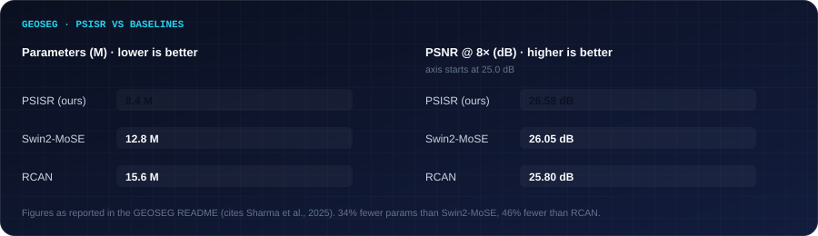

- 🔬 **PSISR:** 3-stage progressive cascade (2× → 4× → 8×) with UBCF blocks, a learnable Pearson correlation filter and PixelShuffle upscaling; adaptive MSE + SSIM loss
- 🗺️ **Segmentation:** ResNet-34 U-Net on a 16-channel input (13 bands + NDVI/NDWI/NDBI) with distance-weighted overlap blending
- ⚡ **Native core:** C++20 engine with AVX2 tiling and normalization, reported up to 4.8× faster than NumPy
- 🖥️ **Viewer:** React + Vite split-view (low-res vs 8×), coordinate HUD, Google/ISRO Bhuvan/Esri/OSM basemaps, preset AOIs including Bhopal

 

### 🛣️ Road Safety AI


One offline-first PWA for crash response, traffic-law compliance, civic issue reporting and authority accountability across all **7 BIMSTEC nations**.


- 🚑 **RoadSoS CrashMode:** one-tap 60-minute "Golden Hour" countdown, offline first-aid, 112/108/100 dialing, trauma-centre navigation, multi-channel alerts (SMS, WhatsApp, email, webhooks)
- ⚖️ **DriveLegal AI:** 154 verified violations, fines by vehicle type, repeat-offence penalties, Motor Vehicles Act citations, Hinglish support
- 🔥 **RoadWatch:** severity-weighted Leaflet heatmap, GPS-tagged reports, upvoting, SLA breach alerts
- 📄 **Challan OCR:** client-side Tesseract.js + server-side pytesseract
- 🧠 **Cascade:** keyword classifier → BiLSTM NER → FAISS RAG work offline; below a 0.65 confidence threshold it escalates to Gemini Flash, with Groq Llama-3.1-70B as fallback

 

### 🏙️ NagarSetu V2.0


A smart-city civic intelligence platform for Bhopal and Indore: citizens get a multi-module Android super-app, and responders get a live **command center** with an SOS queue, tactical map and incident triage.


- 📱 **Android:** Kotlin + Jetpack Compose, 12+ feature modules, plus the Raksha safety module
- 🖥️ **Command Center:** Next.js 15 + TypeScript + Tailwind, three-panel layout (SOS queue · map · triage), runs on mock data without a backend
- 🔌 **Realtime:** Node.js / Express / Socket.IO event stream
- 🧠 **ai_engine:** Python FastAPI + scikit-learn service, built in phases on a 15-phase roadmap

 

### 🛡️ Trinetra V5.0


A multimodal intellectual-property defense registry for the **AI for Bharat** hackathon: register an asset once, then catch duplicates and infringements across images, audio and text.


- 🖼️ CLIP image similarity and CLAP audio embeddings behind a FAISS HNSW index
- 📝 Amazon Titan Embeddings V2 for text, AWS Rekognition for faces and objects, reverse image "Web Peek"
- 🌐 Sarvam AI for 10+ Indic languages
- 🏗️ Refactored from a 3,800-line monolith into a 10-module architecture

## 🧰 More Builds

| Project | What it is | Stack |
|---|---|---|
| 🏜️ **DINOv2 Terrain Segmentation** | 10-class offroad segmentation, Startathon 2026 (E-Cell VIT Bhopal) | PyTorch · DINOv2 · CutMix/MixUp · Focal Loss · EMA |
| 🚖 **RideFlex** | Corporate/SEZ employee ride-hailing with C++ matching engine, ladies-only matching and SOS | FastAPI · Next.js · React Native · C++ (pybind11) |
| 🎓 **ElevateAI** | AI-powered student OS: Student DNA, TrustScore Network, CampusOS | Flutter · Supabase |
| 🧮 **SciCalc** | Scientific calculator with C++/WASM core and Material You dark theme | Next.js 15 · TypeScript · C++/WASM |
| 🎙️ [**Friday_ai**](https://github.com/yajatkataria08-a11y/Friday_ai) | Python voice assistant inspired by Marvel's FRIDAY | Python |

## ⚙️ How I Ship


## 🌌 Tech Constellation

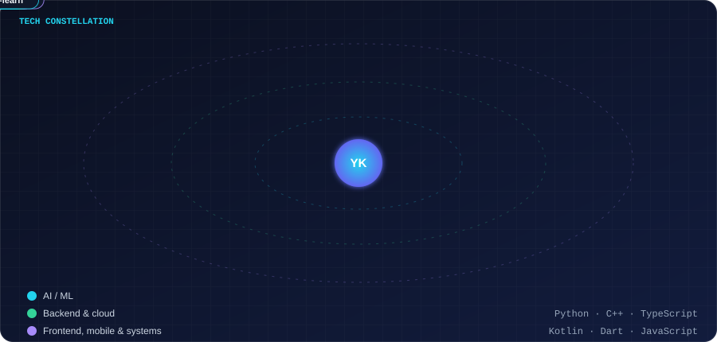

## 🏅 Hackathon Trail

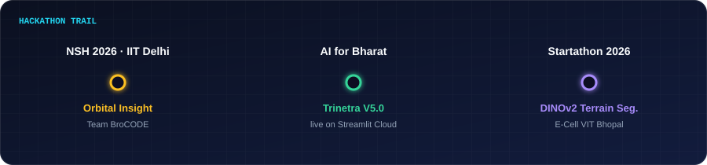

| 🏆 Event | 💡 Project | 🛠️ Stack | 📌 Status |
|---|---|---|---|
| NSH 2026 · IIT Delhi | Orbital Insight | FastAPI · XGBoost · Docker | 🔥 In progress |
| AI for Bharat | Trinetra V5.0 | CLIP · FAISS · AWS | ✅ Shipped & live |
| Startathon 2026 · E-Cell VIT Bhopal | DINOv2 Terrain Segmentation | PyTorch · Streamlit | ✅ Shipped |

## 📊 GitHub Activity

<picture>
  <source media="(prefers-color-scheme: dark)" srcset="https://raw.githubusercontent.com/yajatkataria08-a11y/yajatkataria08-a11y/output/github-snake-dark.svg"/>
  <source media="(prefers-color-scheme: light)" srcset="https://raw.githubusercontent.com/yajatkataria08-a11y/yajatkataria08-a11y/output/github-snake.svg"/>
  
</picture>

## 💻 Competitive Programming

`Binary search on answer` · `Greedy` · `Trees & graphs (BFS/DFS)` · `Dynamic programming` · `Two pointers / sliding window` · `Stack & queue`

## 📚 Currently Learning

| | Focus | Topics |
|---|---|---|
| 🧠 | **Advanced Deep Learning** | Transformers, ViT, Diffusion Models |
| ⚙️ | **System Design** | Scalable ML pipelines & microservices |
| 🔐 | **Cloud Security** | AWS IAM, VPCs, Security Groups |
| 🏎️ | **Competitive Programming** | Codeforces Div 2/3 |
| 🌐 | **Web3 Fundamentals** | Smart contracts & dApps |

## 🤝 Open To

🤝 **Hackathon collabs** (AI/ML, systems) · 💼 **Internships** (AI/ML, full-stack, backend) · 🔬 **Research** (computer vision, NLP, multimodal) · 🌟 **Open source** (Python, ML tooling, FastAPI)

## 📫 Let's Connect

| Platform | Link |
|---|---|
| 📧 Email | [yajatkataria08@gmail.com](mailto:yajatkataria08@gmail.com) |
| 💼 LinkedIn | [linkedin.com/in/yajatkataria](https://linkedin.com/in/yajatkataria) |
| 🧩 LeetCode | [leetcode.com/yajatkataria](https://leetcode.com/yajatkataria) |
| 🟢 HackerRank | [hackerrank.com/profile/yajatkataria08](https://www.hackerrank.com/profile/yajatkataria08) |
| 📍 Location | Indore, India |

